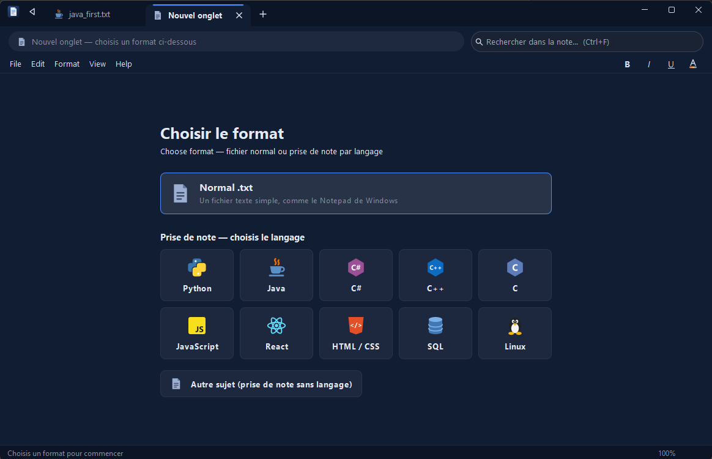
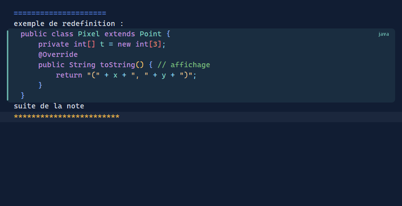
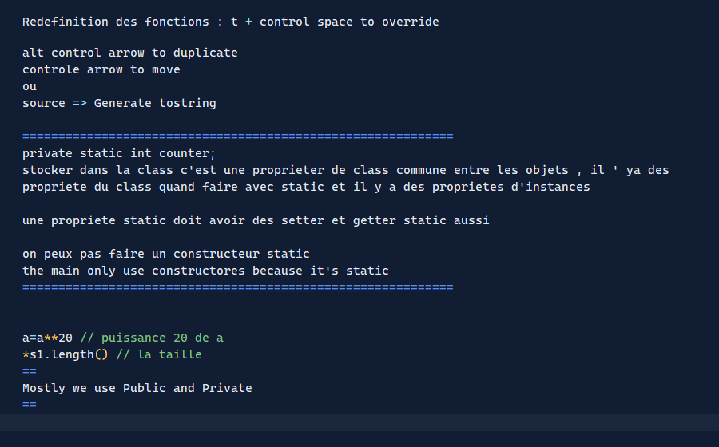
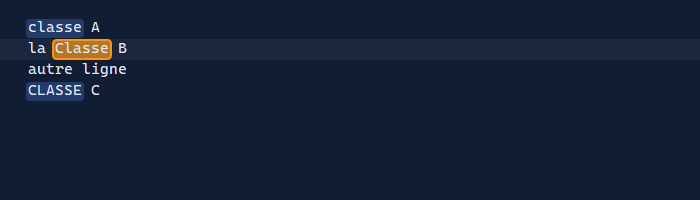

# EasyNotes92

A dark, tabbed notepad for **taking course notes** ("prise de note") while you code.
It looks and behaves like the Windows 11 Notepad, plus shortcuts made for notes:
separator lines, numbered chapters, auto-numbered lists, code blocks with syntax colours,
and autocomplete from the notes you already wrote.

**Created by Mohamed Iraqi Houssaini.** Free, and the source code is public.

Written in **Java 25 / Swing** with **[FlatLaf](https://www.formdev.com/flatlaf/)** for the look and themes.



| Code pasted from an IDE | Colours in ordinary notes | Search with ↑ / ↓ |
|---|---|---|
|  |  |  |

---

## Features

### Like Windows Notepad
- Tabs (in the title bar, like Windows 11 Notepad), **drag a tab to reorder it**
- **Reopens everything you had open**, even unsaved notes, in the same order, same tab, same cursor
- Open / Save / Save As / Save All / Print, recent files (◁ button), drag & drop files **or a whole folder**
- Undo / Redo, Find / Replace, Go To line, Time/Date (F5), Word Wrap, zoom (Ctrl+wheel), status bar
- UTF-8 / UTF-8 BOM / ANSI and CRLF / LF / CR are detected and kept when saving
- Works with Windows Snap (Win+←/→, drag to an edge, snap layouts): the layout adapts down to a quarter of the screen
- Only one window: starting the app again brings the open window to the front

### For taking notes
| Type | You get |
|---|---|
| `==+` | a line of 57 `=` |
| `=+` | a line of 41 `=` |
| `*+` | a line of 24 `*` |
| `**+` | a line of 57 `*` |
| `new heritage` then **Ctrl+Space**, **Enter** | a numbered chapter in this layout:<br>`================…`<br>`			Chapitre 5 : Heritage`<br>`================…` |
| `a)` / `I)` / `1)` then **Enter** | `b)` / `II)` / `2)` on the next line (Enter on an empty item ends the list) |
| a few letters | grey suggestion from your past notes, **Tab** to accept, keep typing to ignore |
| **Ctrl+Alt+↑ / ↓** | duplicate the line(s) |
| **Ctrl+D** | delete the line(s) |
| **Alt+A** | select the whole line(s) |
| **Alt+↑ / ↓** | move the line(s) up / down |
| click under the text | there are always 20 free lines: the click puts the cursor right there |

- **New tab → "Choisir le format"**: a normal `.txt`, or a *prise de note* for Python, Java, C#, C++, C,
  JavaScript, React, HTML/CSS, SQL or Linux. The language shows as a logo on the tab and adds its keywords
  to autocomplete.
- The language is guessed from the file name (`python.txt`, `java_first.txt`, `csharp.txt`…), or from the
  content when the name says nothing (`npm`, `require(`, `const` → JavaScript), and remembered per file.
- **Code blocks**: paste code from an IDE and it gets its own card with syntax colours (keywords, strings,
  numbers, comments, operators, `( )`, `[ ]`, `{ }`). **Ctrl+Shift+K** turns lines into a code block or back.
- **Colours in normal note lines** (prise de note mode): `//` comments green, every `*` like the `*****` lines,
  operators and brackets coloured. Colours are only drawn on screen, files stay plain text.
- Bold / italic / underline / text colour (saved as `.rtf`, a plain `.txt` can't hold them).
- **Format → Note Colors…** to change all 12 note colours, **View → Theme** for 26 themes (default *Night Blue*).

---

## Build and run

Requirements: **JDK 25 or newer** (`javac`, `jar`, `jpackage` on the PATH).

```powershell
# Windows: builds EasyNotes92.exe (with its own Java inside) + a Desktop shortcut
powershell -ExecutionPolicy Bypass -File build.ps1
```
The app goes to `%LOCALAPPDATA%\Programs\EasyNotes92\EasyNotes92.exe` (about 120 MB, no Java needed on the PC).

From an IDE: import the folder as a Java project (Eclipse: *File → Import → Existing Projects into Workspace*),
the two FlatLaf jars in `lib/` are already on the build path, then run `com.esisa.notepad.Main`.

Settings, recent files and the open tabs are stored in `%APPDATA%\EasyNotes92\`
(start Java with `-Deasynotes.dir=<folder>` to use another folder, e.g. for tests).

---

## Project structure

```
src/com/esisa/notepad/
  Main.java              start, theme, single instance
  AppFrame.java          the window: tabs, path + search bars, menus, status bar, open/save, session restore
  NoteEditor.java        one document: text, files, undo, bold/colours, code blocks, separator colours, free space
  NoteAssist.java        ==+ / =+ / *+ / **+, chapters (Ctrl+Space), numbered lists, Tab autocomplete
  CodeColors.java        syntax colours (code blocks + note lines), drawn by a custom text view
  Vocabulary.java        words from past notes, for autocomplete
  Language.java          languages, keywords, detection from file name / content
  TabStrip.java          the tabs (logos, unsaved dot, close, drag to reorder)
  WelcomePanel.java      the "Choisir le format" page
  Theme.java             the 26 themes (Night Blue + FlatLaf theme pack)
  Settings.java          everything remembered between runs
  SingleInstance.java    hands a second launch over to the open window (localhost + token)
  LangIcon.java Glyph.java AppIcon.java   logos, small icons and the app icon, drawn in code
  FindReplaceDialog.java FontDialog.java Ui.java
lib/        flatlaf-3.7.1.jar, flatlaf-intellij-themes-3.7.1.jar
build.ps1   Windows build (jpackage)
docs/       screenshots
```

---

## Roadmap

### 1. Open source on GitHub
- [x] License: PolyForm Noncommercial 1.0.0 (`LICENSE.md`) + `NOTICE.md`
- [x] FlatLaf is **Apache-2.0**: its license text ships with the jars in `lib/LICENSE-FlatLaf.txt`
- [x] `.gitignore` (`build/`, `bin/`, `*.class`)
- [ ] Move the automated tests into the repo (`test/`): they currently live outside the project.
      They cover the shortcuts, chapters, lists, autocomplete, code blocks, colours, search, folder drop,
      session restore and single instance, and they run off-screen
- [ ] Maybe rename the package from `com.esisa.notepad` to something like `io.github.<user>.easynotes`
- [ ] Translate menus or pick one language (today: English menus, French note texts)

### 2. macOS version
The code is plain Java, so most of it already runs on a Mac. What needs work:
- [ ] **Shortcuts**: use **Cmd** instead of Ctrl (`Toolkit.getMenuShortcutKeyMaskEx()`) in `AppFrame` menus;
      **Ctrl+Space** switches the keyboard input source on macOS, so offer another key for chapters/suggestions
- [ ] **Title bar**: tabs-in-title-bar uses FlatLaf full window content; on macOS the window buttons are on the
      left (FlatLaf supports this, the placeholder just has to move left)
- [ ] **Settings folder**: `~/Library/Application Support/EasyNotes92` instead of `%APPDATA%` (`Settings.java`)
- [ ] **Font**: Cascadia Code / Consolas don't exist by default: fall back to *SF Mono* or *Menlo* (`AppFrame.defaultFontFamily`)
- [ ] **"Open folder"**: uses `explorer.exe /select`, use `open -R <file>` on macOS (`AppFrame.openContainingFolder`)
- [ ] **Icon**: write an `.icns` (macOS) next to the `.ico` (`AppIcon.java`)
- [ ] **Build**: `jpackage --type dmg` must run on a Mac; signing + notarization needs an Apple Developer account,
      otherwise users must right-click → Open the first time

### 3. Downloadable versions
- [ ] Windows installer: `jpackage --type msi` (needs the WiX Toolset) or a zipped app folder (no install)
- [ ] GitHub Actions: build on `windows-latest` and `macos-latest` on every tag, attach the `.msi` / `.zip` / `.dmg`
      to a **GitHub Release**
- [ ] Optional: Linux `.deb` with `jpackage --type deb`
- [ ] Optional: code signing for Windows (avoids the SmartScreen warning)
- [ ] A small "Download" section in this README pointing to the latest release

---

## Copyright and license

**Copyright © 2026 Mohamed Iraqi Houssaini**, the creator and author of EasyNotes92.

EasyNotes92 is **free**. Its source code is published under the
**[PolyForm Noncommercial License 1.0.0](LICENSE.md)**. See [`NOTICE.md`](NOTICE.md) for the full terms.

- ✅ You may use it, share it, modify it and add features, free of charge.
- ❌ You may **not sell it**, or sell any modified version, or use it for any commercial purpose.
- 📌 Any copy or modified version you share must stay free, keep `LICENSE.md` and `NOTICE.md`,
  and credit Mohamed Iraqi Houssaini as the original creator.

Anyone who breaks these terms loses the right to use the software. The author may take legal action against them.

**FR —** EasyNotes92 est créé par **Mohamed Iraqi Houssaini**. Il est gratuit et son code est public.
Vous pouvez le modifier et le partager gratuitement, mais **il est interdit de le vendre**,
ou de vendre une version modifiée. Toute copie doit rester gratuite et citer l'auteur original.

FlatLaf © FormDev Software GmbH is used under the Apache License 2.0 ([`lib/LICENSE-FlatLaf.txt`](lib/LICENSE-FlatLaf.txt)).

## Privacy

EasyNotes92 collects **no data**: no account, no ads, no analytics, no internet connection.
Notes and settings stay on your PC. Full policy: [`PRIVACY.md`](PRIVACY.md).

